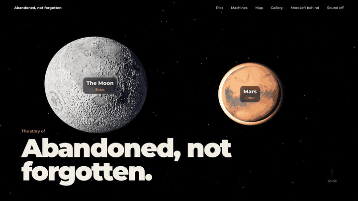
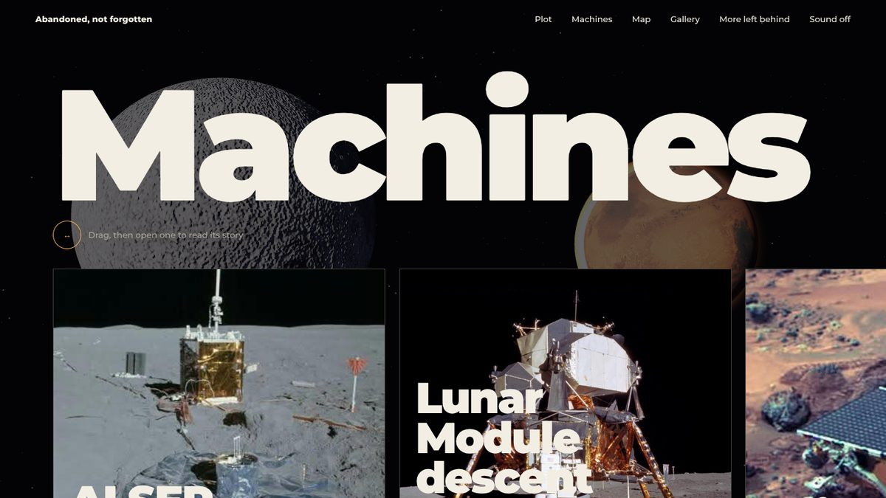
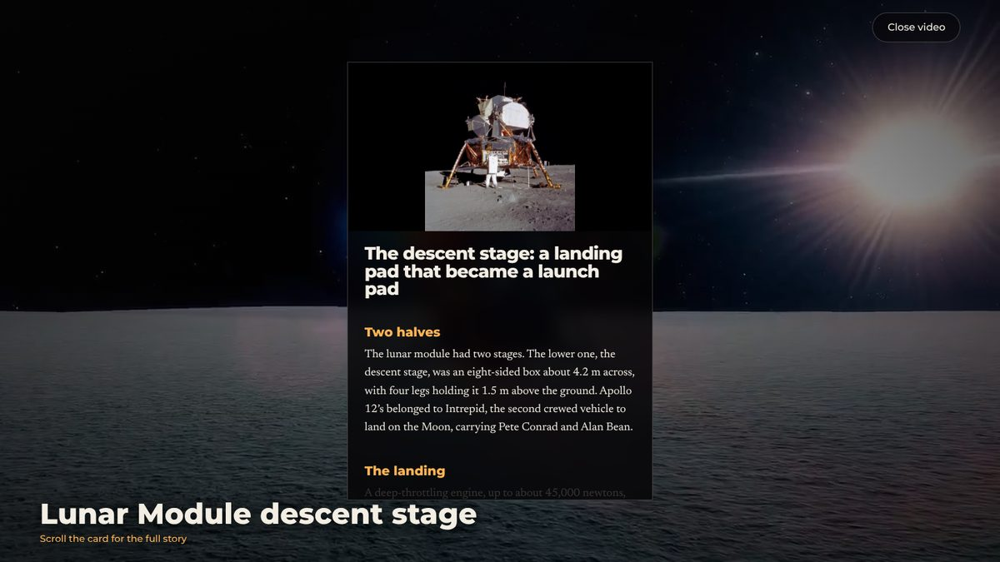
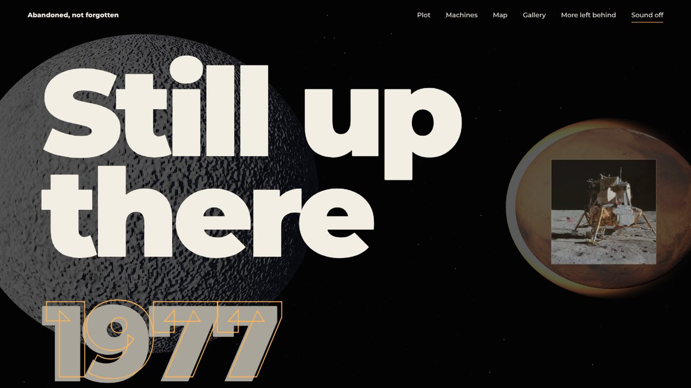
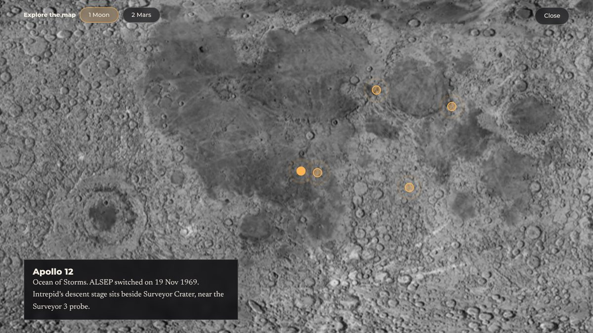

<div align="center">


# 🌑 Abandoned, not forgotten

### They left. The machines stayed.


**[▶ Open the live site](YOUR-LIVE-LINK)**

</div>

---

## 🌌 The idea

Astronauts stayed a few days. The machines they left were built to stay for years.

Some kept listening to the Moon until NASA pulled the plug in 1977. One little rover was meant to last a week and drove for **83 sols**. This site tells their stories, from launch to silence, over real 3D worlds.

<div align="center">

</div>

## 🛰️ Meet the machines

| | Machine | Where | The story in one line |
|---|---|---|---|
| 🌙 | **ALSEP** | The Moon | Nuclear-powered science stations that listened to moonquakes until they were switched off |
| 🚀 | **Lunar Module descent stage** | The Moon | The landing pad that became a launch pad, and still sits in the Ocean of Storms |
| 🤖 | **Sojourner** | Mars | Built for a week. Worked for 83 sols. Still parked in Ares Vallis |

…plus **10 more** abandoned machines (rovers, landers, probes) in the "More left behind" drawer, each linking to NASA.

## 🎬 What you can do

<table>
<tr>
<td width="50%"><br><sub>🃏 Drag through the machines and open one</sub></td>
<td width="50%"><br><sub>🎥 Read each story over a looping video</sub></td>
</tr>
<tr>
<td width="50%"><br><sub>🔢 See what is still up there, in numbers</sub></td>
<td width="50%"><br><sub>🗺️ Find every site on a real map of the Moon and Mars</sub></td>
</tr>
</table>

- 🪐 **Real 3D Moon and Mars.** The camera follows your scroll. Click a planet to fly to its story.
- 📖 **Every story has the same arc:** why it was built, what it found, how it ended, what remains.
- 🎧 **Original ambient score**, generated live in your browser. Or enter silent.
- 📱 **Works on phones**, with keyboard support and reduced-motion mode.

## 🛠️ Built with

A single page of plain **HTML, CSS and JavaScript**, with [three.js](https://threejs.org/) for the planets and the Web Audio API for the music. No framework, no build step.

```bash
# run it locally
npx serve .
```

## 👤 Made by

**Abdullah Zeshan**, a solo build.
[LinkedIn](https://linkedin.com/in/abdullah-zeshan-4706a02a3) · [GitHub](https://github.com/abdullah-zeshan)

## 🙏 Credits

- **Facts:** NASA NSSDCA and NASA mission pages.
- **Photos:** NASA and NASA/JPL-Caltech.
- **Planet textures:** NASA-derived maps from [threex.planets](https://github.com/jeromeetienne/threex.planets).
- **Background videos:** stock footage from [Pexels](https://www.pexels.com/) and [Pixabay](https://pixabay.com/). It is illustrative, not actual mission footage.
- **Music:** original, generated in the browser.

> Independent project. Not affiliated with or endorsed by NASA. Map positions are approximate.

<div align="center"><sub>Made for the NASA Space Apps Challenge 2026.</sub></div>
